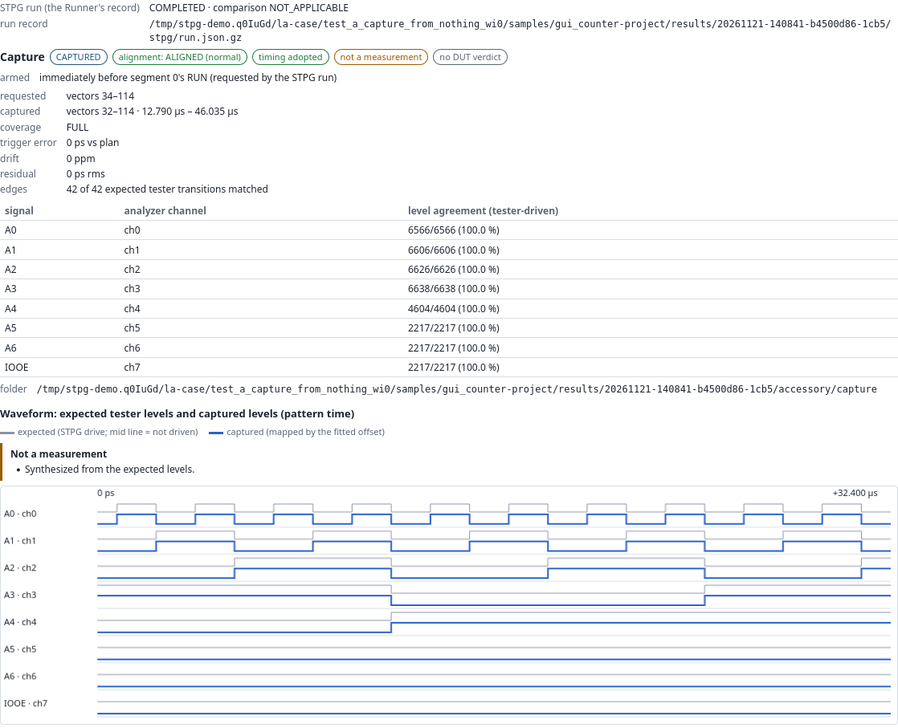

# STPG_RP2350_LA

This is the separate logic-analyzer tool for [STPG_RP2350](https://github.com/okamitsu320/STPG_RP2350).
The distributions are `stpg-rp2350` (core) and `stpg-rp2350-la` (this tool).
Install matching local sources or wheels together. This development version
is `0.1.0.dev7` and requires core `0.1.0.dev7` exactly.
New STPG run records are `run.json.gz`; the shared core reader also accepts
legacy `run.json`, rejecting folders that contain both. Identity links hash
the stored compressed bytes. Re-export accessory configs after changing the
SDK, bundle or Python environment; do not manually replace their hashes.
No firmware or device operation is authorized by these installation instructions.

Captures the real waveform around a chosen vector of an STPG run, with an RP2350 (Pico 2) logic analyzer running the
gusmanb/logicanalyzer V6 firmware. It is a separate program from the STPG software, which starts it as its own process
for one run. It never runs the STPG itself. [GPL-3.0-only](LICENSE) · [Third-party notices](NOTICE.md).

## Try the simulated analyzer

Place matching local source folders `STPG_RP2350` and `STPG_RP2350_LA` beside each other and open a terminal
in `STPG_RP2350`. Both packages install from the local folders. If the core guide already created `stpg-env`,
skip the first line.

Windows PowerShell:

```powershell
python -m venv stpg-env
.\stpg-env\Scripts\python.exe -m pip install . ../STPG_RP2350_LA
.\stpg-env\Scripts\python.exe -m stpg_capture.ui.server --demo --no-device-io --config-dir ./settings-check --results-dir ./la-runs-check
```

Linux (also the command form for macOS; macOS is untested and not actively supported):

```sh
python3 -m venv stpg-env
./stpg-env/bin/python -m pip install . ../STPG_RP2350_LA
./stpg-env/bin/python -m stpg_capture.ui.server --demo --no-device-io --config-dir ./settings-check --results-dir ./la-runs-check
```

See the [source-install walkthrough](manual/setup.md) to open the core alongside the analyzer and try a mock capture.



This capture uses synthesized levels from the public counter example. It is not a measurement.

`stpg-la` and `stpg-capture` are also installed as console commands; they need the environment's Scripts/bin folder
on PATH. The module command above does not. Demo output is not a measurement.

Start with [the manual](manual/README.md).
