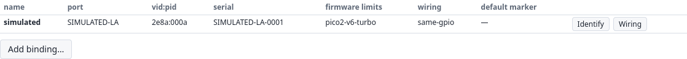
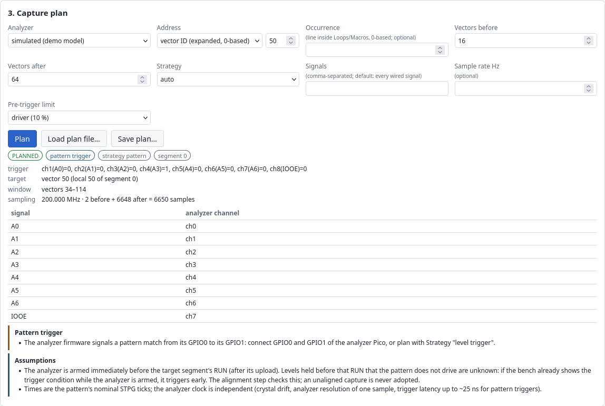
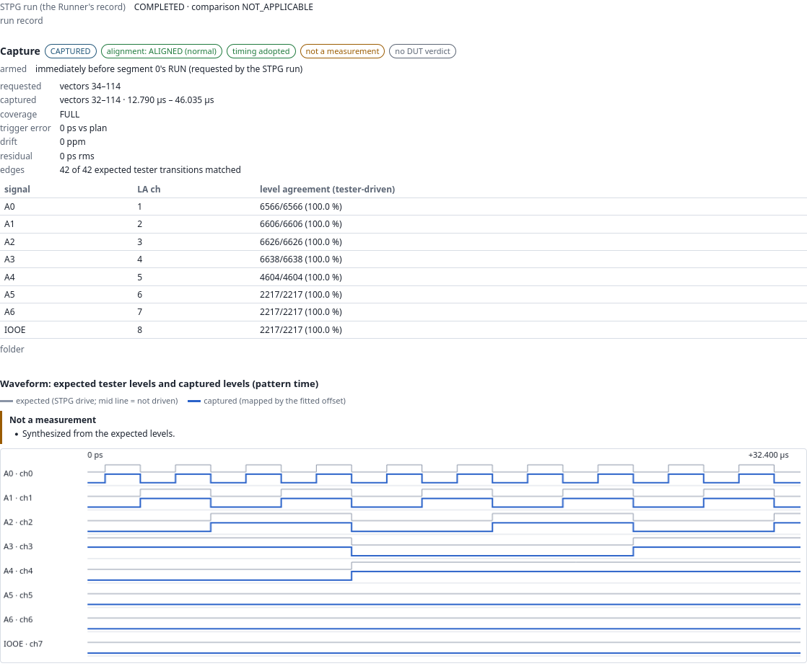

# Set-up and first capture

## What you need

- The STPG software (repository `STPG_RP2350`) installed, so that `python -m stpgview --help` works in its environment,
  and a bundle built with it.
- A Raspberry Pi Pico 2 with the gusmanb/logicanalyzer **V6** firmware. This tool does not include or install that
  firmware. It checks the identity the board reports, exactly.
- Wires from the STPG pins to the analyzer, and a common ground.

No analyzer yet? Use the demo commands below and card 5 for a mock capture. No port is opened or listed.

## 1. Install

The runnable source example assumes these two source folders beside each other. Extract/rename them to these names,
then open a terminal in `STPG_RP2350` (the core folder, not this tool's folder). Python 3.10 or later is required.

```text
your-work-folder/
  STPG_RP2350/       (core pyproject.toml)
  STPG_RP2350_LA/    (this tool's pyproject.toml)
```

Windows PowerShell:

```powershell
python -m venv stpg-env
.\stpg-env\Scripts\python.exe -m pip install . ../STPG_RP2350_LA
```

Linux / macOS:

```sh
python3 -m venv stpg-env
./stpg-env/bin/python -m pip install . ../STPG_RP2350_LA
```

If you already created `stpg-env` for the core, skip its creation and use it. No activation or PATH edit is needed.
The STPG packages are both local sources, not names to find on a public index. Internet access may still be needed
for build dependencies and pyserial. This tool requires exactly the STPG version it was built for: install both
local sources (or both matching wheel files) in one command.

Restart `stpg-view` afterwards; its External accessory card then reports the tool as installed.

## 2. Start

Windows PowerShell, still in the core folder:

```powershell
.\stpg-env\Scripts\python.exe -m stpg_capture.ui.server --demo --no-device-io --config-dir ./settings-check --results-dir ./la-runs-check
```

Linux / macOS:

```sh
./stpg-env/bin/python -m stpg_capture.ui.server --demo --no-device-io --config-dir ./settings-check --results-dir ./la-runs-check
```

The page opens on its own port, separate from `stpg-view`. The terminal prints the address, the settings folder and the
results folder. These commands use local check folders rather than existing user settings. Start the core from the
same folder/environment, following its getting-started guide. Stop each program with Ctrl+C in its terminal.
The console command `stpg-la` is equivalent when the environment is activated.



Actual panel from demo mode. The simulated port and serial here are model identifiers, not attached devices.
The screenshots in this manual omit local path fields and the page header.

For this first check choose the analyzer `simulated`; use mock capture, never a device capture. Scan ports and
Identify cannot contact hardware with `--no-device-io`. Once you are ready for a real analyzer, stop the demo and
start without the demo/no-device flags only after reviewing all wiring and safety conditions below.

| Option | Effect |
| --- | --- |
| `--config-dir FOLDER` | The settings folder, shared with `stpg-view`. Same rule: this option, then `STPG_CONFIG_DIR`, then the per-user default |
| `--results-dir FOLDER` | Where Identify, mock and import results and accessory configs go |
| `--no-device-io` | No port access at all: Scan ports reads nothing and Identify is off |
| `--demo` | Adds an analyzer model named `simulated`. Nothing it produces is a measurement |
| `--no-browser`, `--port N` | Print the address only; use a fixed port |

Check that this page and the STPG Runner show the **same settings folder**. If not, analyzers saved here do not appear
in the Runner: start both with the same `--config-dir` or `STPG_CONFIG_DIR`.

**Browse…** next to a path opens a picker. Type a path and press **Go** (or Enter), or use **Up**, **Home** and the
drive buttons (on Windows every drive letter that exists; a network path such as `\\server\share` can be typed),
then pick from the list. A folder that does not exist is reported; no other folder is opened instead. For a **new**
folder (card 4's New folder, card 6's New project folder), open the folder that will hold it and type the new name:
nothing is created until the tool writes into it, and a name that already exists, also in other upper or lower case,
is refused. Cancel changes nothing.

## 3. Add the analyzer

In card 1 press **Add binding…**.

1. Plug in the analyzer and press **Scan ports**. It reads USB metadata only, opens nothing and selects nothing. Press
   **Use** on the analyzer's row. Take care not to pick the STPG or the GPIO controller.
2. Choose the **firmware limits** of the analyzer firmware you installed: `pico2-v6-turbo` (200 MHz, 400 MHz blast) or
   `pico2-v6` (100 MHz, 200 MHz blast). The USB identity cannot tell them apart, and both report the same name; only
   the limits differ, and Identify reads them.
3. Choose the **wiring** (next section).
4. Leave **Advanced** alone unless you plan marker captures: the default marker GPIO is optional, and no pin is chosen
   for you.
5. Save, then press **Identify**. It opens only this port, asks for the identity and closes it, and saves a record first.

If the board reports other limits, the result says so and offers **Use the reported values in this binding…**. Review
the form and Save. Nothing is rewritten until you press Save, and a run refuses an analyzer that does not match.

## 4. Wire it

Press **Wiring** on the binding for its exact table.

| Preset | Connections | Observed |
| --- | --- | --- |
| `same-gpio` | Analyzer GPIO2–22 and 26–28 to the STPG GPIO with the same number | 23 of 24 pins: STPG GPIO23 has no analyzer input |
| `stpg20-23-to-la19-22` | STPG GPIO20–23 to analyzer GPIO19–22, the rest the same number | All 24 pins |

Other boards can use an explicit map in the binding file (`{"analyzer_gpio": {"20": 19, …}}`).

**Pins a capture uses up:**

- **Analyzer GPIO0 and GPIO1** carry no signal input. A **pattern trigger** needs them wired together: the firmware
  raises GPIO0 on a match and starts on GPIO1. Without that wire it never fires. Level and marker triggers do not use them.
- A **marker pattern** uses one spare STPG pin that is wired to the analyzer and that your pattern does not use. Check on
  your bench that nothing else is on that pin: the STPG drives it.
- Connect the grounds. Plan again after changing the wiring.

While capturing, the analyzer may stop on any byte it receives, so do not connect other tools to it.

## 5. Plan

In card 2 open the bundle you built in the Runner: its **folder** is shown in the Runner's bundle card, and it holds
`runner.bundle.json`. In card 3 choose the analyzer and the vector, then **Plan**. See
[Plans, triggers and results](capture.md).



Actual demo plan for vector 50 of the public `gui_counter.stil` sample. No analyzer was armed. With that sample,
enter `50` in Address and leave the other plan fields at their defaults to reproduce this view.

## 6. Use it in a run

In card 4 choose the mode (`device`, or `simulated` for the Runner's demo STPG) and **Write accessory config**. This makes
a new folder holding `external.json`, a copy of the binding and the plan. Files in it must not be changed afterwards:
the Runner refuses a config whose files differ. To change anything, write a new folder.

In the STPG Runner's **External accessory** card choose that `external.json`, press **Check**, tick **use with the next
run**, and press **Run…**.

The config records three limits, shown in the Runner's confirmation: **open** (host time to validate before READY,
60–3600 s, from the check time here), **arm/complete** (5–20 s, from the capture's bounded wait) and **stdin EOF grace**
(5 s). A slower computer can still exceed them; nothing is retried.

The config folder and the run's `accessory/` folder contain local folder names and USB serial numbers. Review them
before sharing.

After updating the STPG software or this tool, rebuild the bundle and write a new config. The program in the config is
the Python of this environment; its hash does not attest the installed packages.

## 7. See the capture

In card 7 open the run's folder (or its `accessory/` folder): outcome, alignment, adoption and a waveform of expected
and captured levels. The STPG's own result stays in the Runner.



Actual simulated capture panel, synthesized from the public counter's expected levels. It is not a measurement.
The browser test `test_two_programs_browser.py` generates these panels by completing the two-program demo with
hardware access disabled and an empty PATH. See [Testing](testing.md).
